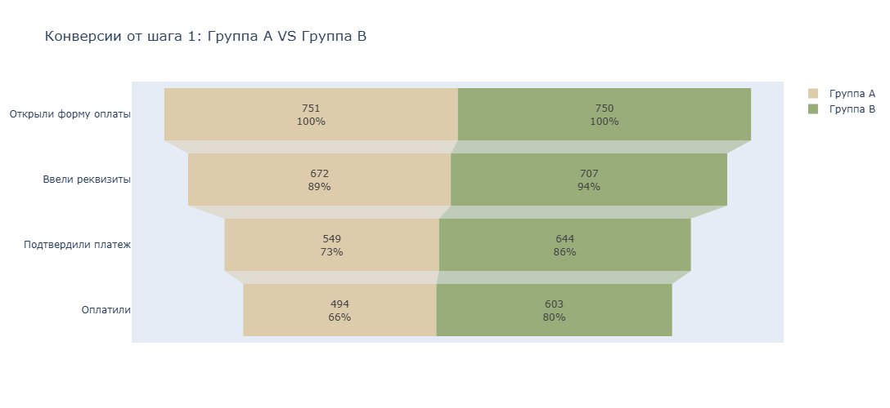

# A/B-тест новой формы оплаты ЖКХ с автозаполнением реквизитов

### Задачи проекта
Главная задача - провести анализ результатов A/B-теста и определить, влияет ли новая форма оплаты ЖКХ с автозаполнением реквизитов на долю успешных оплат.

Области для анализа:
• Разведочный анализ данных (EDA)  
• Работа с выбросами и некорректными записями  
• Визуализация результатов  
• Статистическая проверка гипотез (с обоснованием выбранного метода)  
• Формулировка рекомендации на основе данных  

### Выводы
#### Разведочный анализ данных (EDA) и работа с выбросами и некорректными записями
В таблице users исключены из анализа:  
- Пользователь с пропущенным значением в поле group (id 9001, отсутствовал в таблице платежей).  
- Аномальные значения возраста (-5 у id 9002 и 150 у id 9003), по которым совсем  отсутствовали данные в таблице с попытками платежей, поэтому и исключены.  
Итоговый размер выборки после очистки составил 1503 пользователя (по 751–752 пользователя в каждой группе, распределение равномерное).  

Таблица payments: Содержала 2661 запись с множественными попытками оплаты по пользователям (от 1 до 4 попыток на клиента). Поэтому повторные попытки не учитывались как отдельные пользователи при расчёте конверсии.  
Проверка последовательности шагов воронки не выявила временных аномалий или нарушений логики (даты строго в пределах апреля 2024 года, каждый последующий шаг происходил после предыдущего).  
Обнаружен пользователь 1010, которому в таблице платежей присвоены разные экспериментальные группы. Для корректного определения принадлежности к эксперименту использована таблица users как источник истины.  

Рандомизация: Сплитование по пользователям было проведено корректно — распределение контрольной (A) и тестовой (B) групп по возрасту, городам и типам устройств (iOS / Android) сбалансировано, критических перекосов нет.  

#### Визуализация результатов

#### Статистическая проверка гипотез (с обоснованием выбранного метода)
Для оценки конверсии уникальный пользователь учитывался как успешно оплативший (step4_success), если хотя бы одна из его попыток завершилась успехом.  
По результатам обработки данных в группе A 751 пользователь открыл форму, 494 успешно оплатил, конверсия в оплату - 65,78%. В группе B 750 открыли форму, 603 оплатили, конверсия в оплату 80,4%. Наиболее заметное улучшение в группе B по воронке происходит между вводом реквизитов и подтверждением платежа. Это может свидетельствовать о том, что новая форма упрощает процесс заполнения данных и снижает вероятность отказа от оплаты на данном этапе.  
Для проверки результатов использован критерий хи-квадрат Пирсона, так как он подходит для сравнения конверсий: пользователь либо совершил успешную оплату, либо нет.  
Гипотезы:  
- H0: Конверсия в платящих пользователей не зависит от группы (то есть конверсии в группах a и b статистически не различимы)   
- H1: Конверсия в платящих пользователей  зависит от группы (то есть конверсии в группах a и b статистически различимы)  
Полученное значение p-value значительно меньше установленного уровня значимости 0,05.  
Следовательно, нулевая гипотеза отвергается. Между группами A и B обнаружены статистически значимые различия в конверсии в успешную оплату.

#### Формулировка рекомендации на основе данных
Итоговая рекомендация: Запускать новую форму на всех пользователей (раскатывать на 100% аудитории). Относительный прирост конверсии в успешную оплату составил 14.62%.
